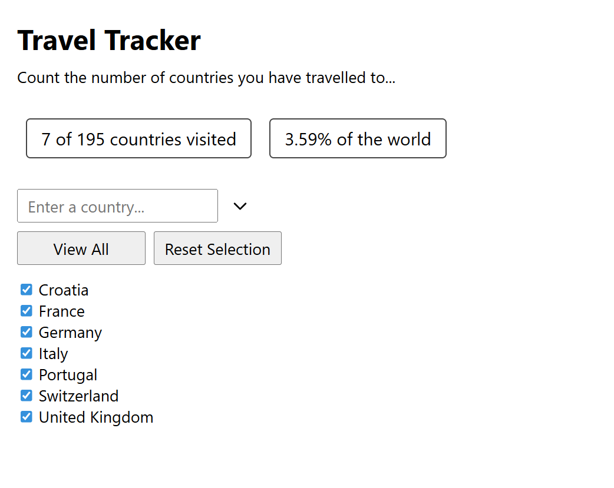

# Travel Tracker
A lightweight country-visit tracker built with AngularJS. Keep track of the countries you've visited, monitor  progress and save selections between sessions.



## Features
- **Country selection:** Browse a predefined list of countries and mark those you've visited.
- **Search and filtering:** Quickly find countries by name.
- **Visited countries:** Switch between viewing all countries and only those you've selected.
- **Progress tracking:** View the total number of countries visited and percentage of the full country list.
- **Persistent storage:** Saves country selections in browser local storage, retaining progress between sessions.
- **Reset functionality:** Clear all selections and start again.

## Technologies
- AngularJS 1.8.3
- JavaScript
- HTML5
- CSS3
- Browser Local Storage

## Getting Started

### Installation
Clone the repository:

```bash
git clone https://github.com/fran-mowat/travel-tracker.git
```

Navigate to the project directory:

```bash
cd travel-tracker
```

### Running Locally
The project is a static web application and does not require npm packages or a build process.

One option is to use Python's built-in HTTP server:

```bash
py -m http.server 8000
```

Open your browser and navigate to:

```text
http://localhost:8000/
```

Alternatively, open the project in Visual Studio Code and use the Live Server extension.